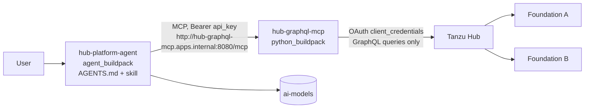

# hub-graphql-mcp

Read-only Cloud Foundry inventory, role and service-health tools backed by the **Tanzu Hub
GraphQL API**, plus an example Tanzu agent that uses them.

| Folder | What it is |
|---|---|
| [`mcp-server/`](mcp-server/README.md) | The MCP server (FastAPI + FastMCP, Python, `python_buildpack`). Seven read-only tools across every foundation attached to Hub. |
| [`agent/`](agent/) | An example agent for the `agent_buildpack`, configuration only: `AGENTS.md`, the `tanzu-hub-platform` skill, and a manifest binding the server. |
| `scripts/deploy.sh` | Deploys both, in order, into the targeted space. |



## How the pieces fit

- **Server.** Authenticates to Hub as a service account (Global scope, Viewer role) and serves
  `/mcp` on an internal route. Tool descriptions and server instructions tell any MCP client
  what each tool does; the agent buildpack adds the instructions to the agent's system prompt.
- **Agent.** `AGENTS.md` sets the persona and rules (read-only, name the foundation, flag
  partial results). The skill in `agent/.agents/skills/tanzu-hub-platform/SKILL.md` holds the
  workflows (health triage, MySQL deep dive, access audit, inventory) and how to read results.
  Only the skill's name and description enter the prompt until the agent needs it.
- **Binding.** A user-provided service tagged `mcp-server` with `url` and `api_key`; the agent
  sends the key as `Authorization: Bearer`, which the server accepts. A network policy lets the
  agent reach the server's `apps.internal` route.
- **No drift.** `mcp-server/tests/test_agent_example.py` fails if the skill or `AGENTS.md`
  name a tool or argument the server does not have, if a tool is missing from the skill, or if
  the manifests and the deploy script disagree on names.

## Deploy

Prerequisites: `cf`, `jq`, `openssl`; the agent buildpack installed (`cf buildpacks`); an
`ai-models` plan in the space; a Hub service account (see
[mcp-server/README.md](mcp-server/README.md#setup)).

```bash
cf login -a https://api.sys.<FOUNDATION-DOMAIN> --sso && cf target -o <ORG> -s <SPACE>
cp .envrc.example .envrc            # fill in; git-ignored
set -a; source .envrc; set +a
scripts/deploy.sh                    # or: scripts/deploy.sh server | agent
```

The script:
1. Creates or updates `hub-graphql-mcp-creds` (service account + MCP API key; an existing key
   is kept) and pushes `mcp-server/`.
2. Creates `hub-graphql-mcp-tools` (`mcp-server` tag, internal URL + API key) and
   `hub-platform-model` (`ai-models`), pushes `agent/`, sets `DEFAULT_MODEL` if given, binds
   SSO if `SSO_PLAN` is set, adds the network policy, and starts the agent.

Bind SSO (`p-identity`) for anything beyond a demo: the agent can list who holds which roles.

Check: open the agent's route, then the debug panel: MCP server `hub-graphql-mcp-tools`
connected with seven tools. Try the welcome suggestions, for example "Which service instances
are unhealthy right now?".

## Use the skill elsewhere

The skill is plain Markdown. To use it from Cursor or Claude Code against the same server,
copy or link `agent/.agents/skills/tanzu-hub-platform/` into that tool's skills folder and
configure the MCP server as in [mcp-server/README.md](mcp-server/README.md#deploy-to-cloud-foundry).

## Develop

```bash
cd mcp-server
uv sync
uv run pytest            # includes the agent consistency tests
uv run ruff check .
```

When you add or change a tool, update the skill in the same change; the tests point at what
is out of date.
